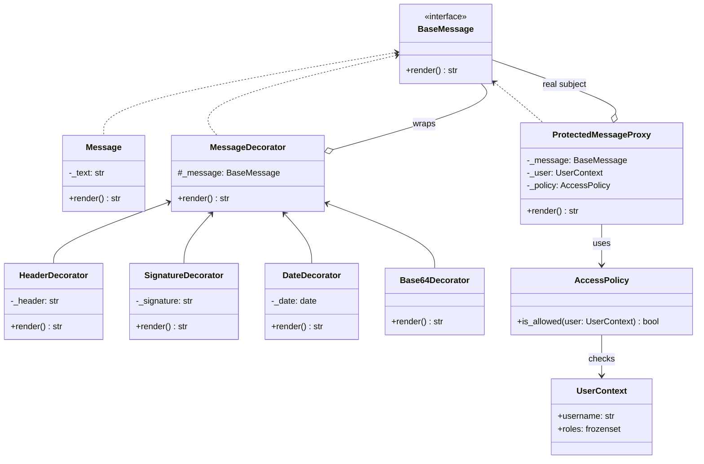

# Структурная диаграмма

# Decorator и Proxy: сравнение

Критерий: Decorator / Proxy 
 Назначение:  Добавляет объекту новое поведение / Контролирует доступ к объекту 
 Содержание результата:  Изменяет результат render() / Возвращает результат без изменений 
 Количество обёрток:  Можно вкладывать друг в друга в любом порядке / Обычно один заместитель 
 Кто хранит ссылку:  Декоратор хранит декорируемый BaseMessage / Proxy хранит реальный субъект 
 Логика в проекте:  Формирование текста (заголовок, подпись, дата, Base64) / Проверка AccessPolicy перед вызовом 
 Результат при отказе:  Не применяется / PermissionError 

Итог: у Decorator и Proxy одинаковая структура (оба реализуют BaseMessage и хранят ссылку на другой объект), но разные задачи. Decorator расширяет поведение, а Proxy защищает доступ и не меняет содержимое сообщения.